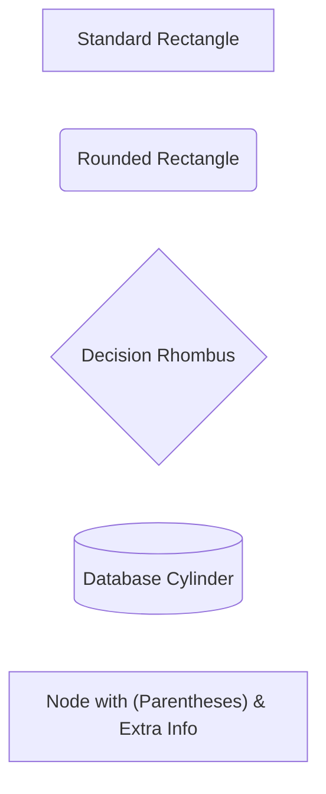
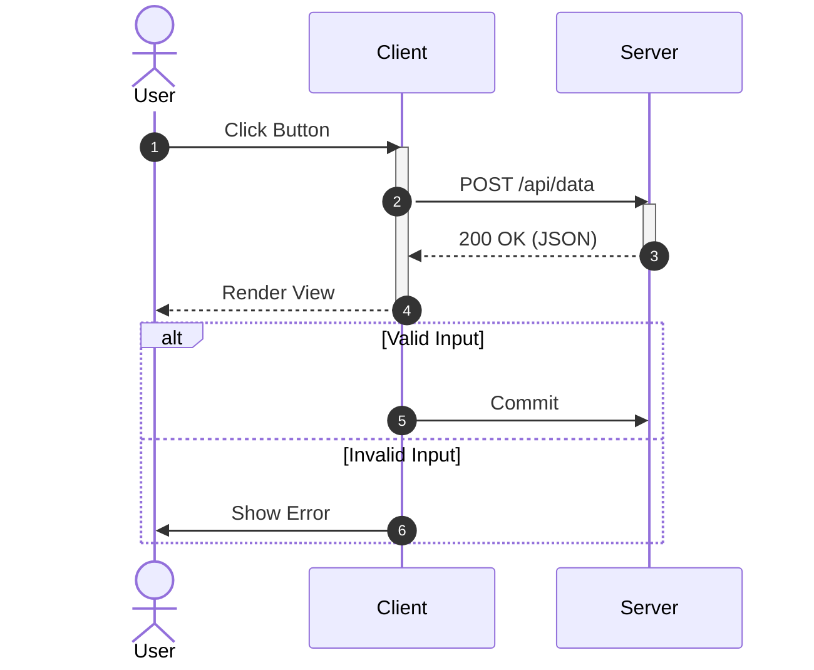
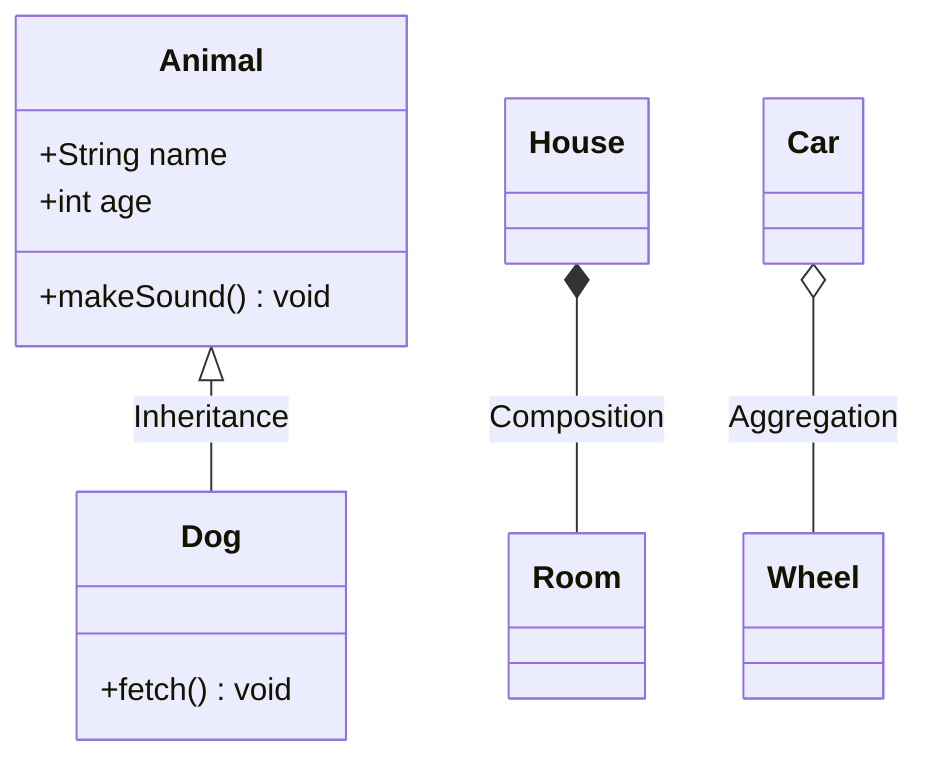
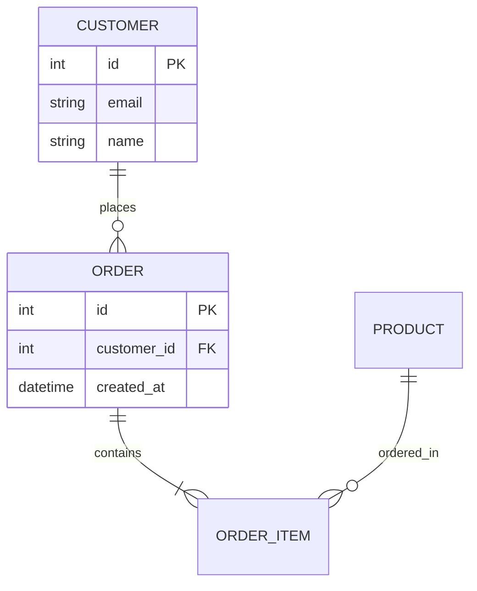

# Common Mermaid Diagram Types & Syntax Reference

Quick reference for writing clean, valid Mermaid diagrams across all supported diagram types.

---

## 1. Flowcharts (`flowchart TD` / `flowchart LR`)

### Direction
- `TD` or `TB`: Top to Bottom
- `LR`: Left to Right
- `BT`: Bottom to Top
- `RL`: Right to Left

### Node Shapes & Special Character Quoting
> [!IMPORTANT]
> If a node label contains parentheses `()`, brackets `[]`, braces `{}`, or quotes, **always wrap the label in double quotes** inside the shape delimiters!

### Links & Arrow Syntax
- Normal: `-->`
- Open link: `---`
- Text on link: `-->|label|` or `-- label -->`
- Dotted: `-.->` or `-. text .->`
- Thick: `==>` or `== text ==>`

---

## 2. Sequence Diagrams (`sequenceDiagram`)

### Gotchas:
- All blocks (`alt`, `opt`, `loop`, `par`, `critical`, `rect`) **must** be terminated with a matching `end`.
- Use `->>` for synchronous messages (solid arrow with filled head), `-->>` for reply messages (dashed arrow with open head).

---

## 3. Class Diagrams (`classDiagram`)

### Visibility Modifiers:
- `+`: Public
- `-`: Private
- `#`: Protected
- `~`: Package / Internal

---

## 4. Entity-Relationship Diagrams (`erDiagram`)

### Cardinality Notations:
- `||`: Exactly one
- `|{` / `}|`: One or more
- `|o` / `o|`: Zero or one
- `o{` / `}o`: Zero or more
