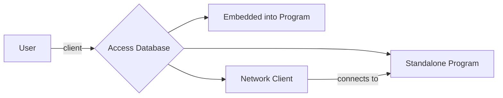
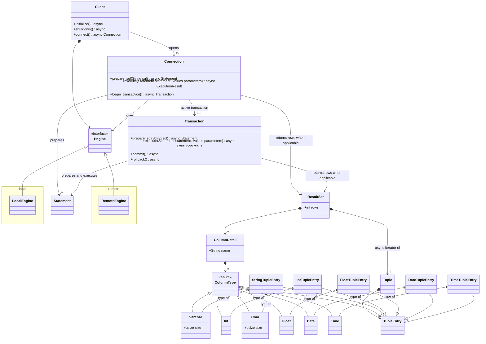
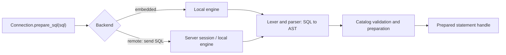
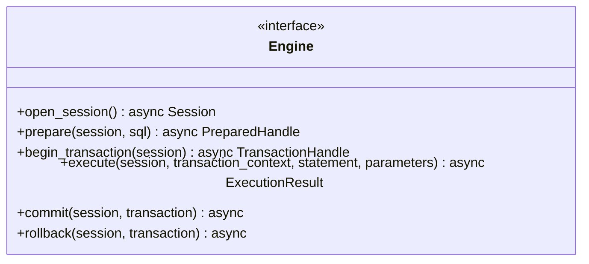
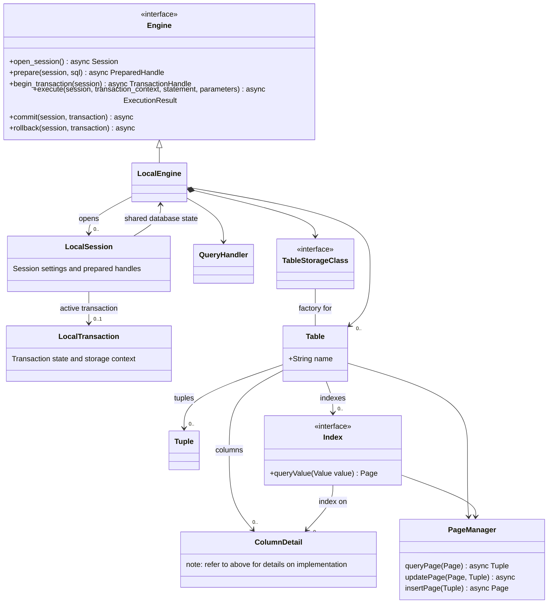

# Design of the Database

## Interaction between User and Database

The user can interact with the database as shown below:

## Database Client

The database client can be modeled as follows:

`Client<E: Engine>` is the database handle: it owns backend configuration and
initialization/shutdown, and opens independent connections. A `Connection` is one
logical session. It may use a socket for a remote backend; an embedded connection
needs no socket. Connections share the underlying local engine and storage while
keeping their session and transaction state separate.

A transaction is a unit of work within a connection, not a replacement for that
connection. Preparation belongs to the connection and is also exposed through a
transaction. Execution goes through `Connection.execute` or `Transaction.execute`
so its transaction context is explicit; a statement does not choose that context.

## SQL String Parser

`Connection.prepare_sql(sql)` delegates preparation to its backend/session. With an embedded
local engine, parsing happens in the application process. With a remote engine,
the client sends SQL to the server and the server's local engine parses it. The
server validates names and types against its catalog and may create an execution
plan. The parser itself performs syntax analysis only.

The AST remains internal to the local engine. The network protocol carries SQL
and separately encoded parameter values, rather than serialized Rust AST types.
This lets the AST evolve without making each parser change a protocol change.

### Prepared statements and parameters

Preparation accepts SQL containing positional `?` placeholders. Execution accepts
an ordered list of typed values. Each placeholder has its own one-based position,
in source order across the whole statement, including subqueries. For example,
`SELECT name FROM users WHERE id = ? AND active = ?` binds `[42, true]`.
The parser represents these as `Expression::Parameter(1)` and
`Expression::Parameter(2)`; it does not bind or interpolate values.

A local statement retains a backend-specific prepared handle. A remote statement
retains a server-issued statement ID associated with its connection/session.
Executing it sends that ID and the parameter values. The engine checks parameter
count and type compatibility and reports binding or execution errors. Repeated
execution can supply different values without reparsing the SQL.

Client libraries may later offer `:name` or `$1` notation. They must normalize it
to `?` before preparation and reorder or duplicate execution values to match each
occurrence. This requires SQL-aware handling that preserves quoted text and comments.
For example, two occurrences of `:id` become two `?` placeholders with the same
value supplied twice. Only `?` is supported by the current parser.

Placeholders represent values, not identifiers, keywords, or SQL fragments.
See the parser design for the currently supported expression positions.

More details regarding the Lexer and Parser semantics, see [here](./sql_query_parser.md).

## Database Engines

The database engine is defined with the following class diagram:

The planned shared Rust `Engine` trait provides the backend operations shown
above; `Session`, `PreparedHandle`, and `TransactionHandle` are backend-specific
handles. `Connection` and `Transaction` wrap these operations for application code.
Begin with a generic `Client<E: Engine>` for backend selection at compile time.
Runtime trait-object dispatch can be introduced if needed.

`Connection.execute` outside an explicit transaction starts an implicit transaction
and commits successful work or rolls it back on failure. For streamed results,
completion includes consuming or closing the result stream; the implementation
must define cleanup for abandoned streams before releasing the transaction.
`Transaction.execute` always uses that transaction's session and transaction handle.
Commit and rollback end the transaction; further operations through it are invalid.

In Rust, start with `Transaction<'conn>` borrowing `&mut Connection` to prevent
unrelated operations on that connection while a transaction is active. Pass the
transaction explicitly to helper functions. Dropping an unfinished transaction
must arrange rollback before the session can be reused; async cleanup must be
handled by the backend rather than assuming `Drop` can await.

Prepared statements are valid only on their originating session and must be
rejected on other connections. Initially, statements prepared through a transaction
may be restricted to its lifetime. A connection-prepared statement may be executed
through a transaction on that same connection. Handles must also be invalidated or
revalidated when schema changes make their prepared metadata or plans stale.

Execution returns a fallible result containing either row metadata and a row stream,
or command completion with an affected-row count where applicable. DDL does not
need to manufacture a result set.

The same execution entry point handles DML and DDL, including CREATE/DROP INDEX
and ALTER TABLE/VIEW/INDEX. The local engine validates DDL against its catalog and
coordinates schema and storage updates. Index maintenance also happens during
INSERT, UPDATE, and DELETE. These are planned engine responsibilities; the current
engine crate remains a scaffold.

### Local Storage

The local storage can be organized as shown:

The local engine owns shared database state: catalog, tables, indexes, and the
page/storage manager. It must not hold a single global current transaction.
Each local session identifies its own active transaction, and execution passes
that context down to storage. Commit/rollback need actual storage support for
atomicity and isolation; adding session handles alone does not provide those
properties. Transactional DDL and catalog updates must participate in the same
commit/rollback mechanism when supported.

The current `engine/src/lib.rs` contains only the generated `add` function and its
test. These engine/session interfaces and transaction semantics are design targets,
not implemented functionality.

### Remote Storage

Remote storage means there is an instance of the database running a specific protocol on the network. On the other end of the network would be local storage or a custom engine which stores this another way. This requires an instance of the "standalone" sql db to be running at an address. More info about this [here](./remote_sql_db.md).
