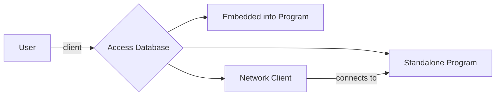
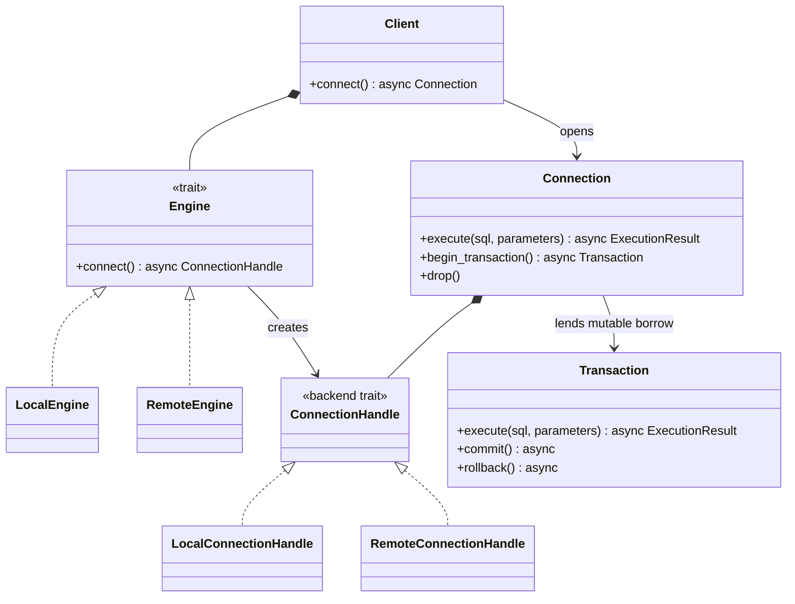
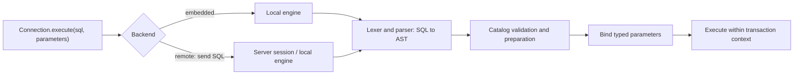

# Design of the Database

## Implementation status

The `engine` crate now provides the generic `Client<E>`, `Engine`,
`Connection<H>`, `ConnectionHandle`, `Executable`, `Transaction`, and `Completion`
API. Local and remote engines, SQL preparation, storage, and backend execution
remain unimplemented. The diagrams below describe the intended architecture;
backend-specific classes are design targets.

Current execution returns buffered `ResultSet` values and string errors. Streaming,
column metadata, unified errors, and a fallible explicit connection-close API are
future work. Generate the Rust API reference with `cargo doc --workspace --no-deps`.

## Interaction between User and Database

The user can interact with the database as shown below:



## Database Client

`Client<E: Engine>` is the application-facing database handle. It owns a
configured engine and opens independent connections. Backend configuration such as
a database path or server address is supplied when constructing the engine;
`Engine::connect(&self)` takes no additional arguments.



`Connection<H: ConnectionHandle>` is a public struct wrapping a backend-specific
session handle. `H` is the connection handle created by the engine, not the engine
type. For example, `Client<LocalEngine>` opens a
`Connection<LocalConnectionHandle>`, while `Client<RemoteEngine>` opens a
`Connection<RemoteConnectionHandle>`. Rust infers these types at call sites.
Dispatch is at compile time; boxed trait objects are not required.

A connection is one logical session. An embedded handle references shared database
state and owns session state; a remote handle owns a network session.
`Transaction<'conn, H>` borrows `&mut Connection<H>` so other operations on that
connection are unavailable until the transaction ends. Execution through the
connection uses autocommit; execution through the transaction uses its explicit
transaction context.

## SQL String Parser

The planned parser is the upstream [`sqlparser` crate](https://docs.rs/sqlparser/),
also known as [sqlparser-rs](https://github.com/apache/datafusion-sqlparser-rs).
The custom parser crate has been removed; upstream integration is planned. The local engine will adapt upstream
syntax AST nodes into database-owned schema and execution representations and
reject unsupported features during preparation. Storage will use those
database-owned types rather than depending on a parser's syntax AST.

`Connection::execute(sql, parameters)` delegates preparation and execution to its
backend/session. With an embedded
local engine, parsing happens in the application process. With a remote engine,
the client sends SQL to the server and the server's local engine parses it. The
server validates names and types against its catalog and may create an execution
plan. The parser itself performs syntax analysis only.

The AST remains internal to the local engine. The network protocol carries SQL
and separately encoded parameter values, rather than serialized Rust AST types.
This lets the AST evolve without making each parser change a protocol change.



### Prepared statements and parameters

Preparation accepts SQL containing positional `?` placeholders. Execution accepts
an ordered list of typed values. Each placeholder has its own one-based position,
in source order across the whole statement, including subqueries. For example,
`SELECT name FROM users WHERE id = ? AND active = ?` binds `[42, true]`.
The planned engine preparation adapter will assign these positions from upstream
placeholder nodes; parsing does not bind or interpolate values.

The current public entry point is
`execute(&mut self, query: &str, values: &[Values])`. `Values` is the current name
of the scalar value enum (`Value` in the planned examples). Backend implementations
are responsible for preparing SQL internally and binding values separately; it never interpolates
parameters into SQL text. `Value` is an enum covering supported SQL values,
including NULL, strings, integers, floats, and other supported scalar types.
Parameter count and type compatibility are checked before execution.

An explicit public `prepare` method is not required initially. Parameterized
execution does not promise reuse of a prepared plan: session-local caching or an
explicit reusable statement API may be added later. Any cached prepared handles
must remain scoped to their originating session and be invalidated or revalidated
when schema changes make their metadata or plans stale.

Client libraries may later offer `:name` or `$1` notation. They must normalize it
to `?` before preparation and reorder or duplicate execution values to match each
occurrence. This requires SQL-aware handling that preserves quoted text and comments.
For example, two occurrences of `:id` become two `?` placeholders with the same
value supplied twice. Only `?` is part of the database's parameter contract;
upstream support for other spellings does not expand that contract.

Placeholders represent values, not identifiers, keywords, or SQL fragments.
See the parser design for the integration plan and parameter contract.

## Database Engines

The `Engine` trait creates backend-specific connection handles. Operational
methods belong to the public backend connection-handle abstraction and its transaction
support, rather than taking session and transaction IDs on `Engine`.
The public wrappers provide a consistent API over those handles.

The following simplified sketch illustrates the implemented type relationship:

```rust,ignore
trait Engine {
    type Handle: ConnectionHandle;

    async fn connect(&self) -> Result<Self::Handle, Error>;
}

struct Client<E: Engine> {
    engine: E,
}

struct Connection<H: ConnectionHandle> {
    handle: H,
}

impl<E: Engine> Client<E> {
    async fn connect(&self) -> Result<Connection<E::Handle>, Error> {
        let handle = self.engine.connect().await?;
        Ok(Connection { handle })
    }
}
```

`Transaction<'conn, H>` holds an exclusive connection borrow and backend-specific
transaction state. `commit(self)` and `rollback(self)` consume the transaction;
after completion the connection can be used again. Pass a mutable transaction
reference explicitly to helpers. Dropping an unfinished transaction must arrange
rollback before session reuse. Ordinary Rust `Drop` cannot await, so cleanup must
be managed by the backend; a session whose cleanup fails must not be reused.

### Completion and cleanup

`ConnectionHandle::commit_transaction` and `rollback_transaction` are synchronous
trigger methods returning `Completion`. Calling them must start or enqueue work
immediately. The completion wraps a `futures_channel::oneshot` receiver carrying
`Result<(), String>`; `wait(self)` asynchronously observes that result without
requiring Tokio. The channel does not execute or schedule the operation.

The transaction sets its internal `finished` flag after triggering the operation
and before awaiting it. This flag means cleanup responsibility has transferred to
the backend. Cancelling that wait must not cancel the operation or cause the guard
to trigger rollback again. Dropping an unfinished guard triggers rollback and
discards its completion receiver.

Backend implementations must:

- Continue triggered work when the completion receiver is dropped.
- Serialize later session operations behind pending transaction completion.
- Record failures independently of result delivery, invalidating a session when
  its state cannot be recovered.
- Handle cancellation during `begin_transaction`, when no guard has yet been
  returned, without leaving an untracked active transaction.
- Handle trigger/enqueue failure synchronously by leaving the session safe or
  unusable; the current trigger signatures have no separate enqueue-error result.

If the completion sender disappears, `wait` returns `"Completion channel closed"`.
That indicates loss of confirmation, not a known commit or rollback outcome.

`Connection::drop` currently calls the synchronous `ConnectionHandle::close(&mut
self)` hook. This hook must release resources or arrange cleanup that survives
handle destruction, without committing unfinished work. It should not panic or
block waiting for asynchronous work. It returns no error or completion, so callers
cannot currently await connection closure or observe cleanup failure. A consuming,
fallible async `Connection::close(self)` is a possible future extension.

These are backend contracts; the generic wrappers alone do not enforce database
atomicity, operation ordering, or cleanup progress.

### Current execution results

`Executable::execute` currently returns `Result<ResultSet, String>`:

- `Rows(Vec<Vec<Values>>)` contains fully buffered rows in column order.
- `AffectedRows(u64)` reports a command's affected-row count.
- `LastInsertId(u64)` reports a generated insert identifier.

This representation has no column metadata or explicit DDL-success variant, and
cannot report an affected-row count together with an insert ID. `Unknown` in
`Values` is provisional and has no defined binding semantics. Connection opening
uses the crate's `Error` enum; execution and completion currently use strings.
The following section describes the intended evolution of this API.

### Planned execution results and column metadata

The planned API returns `Result<ExecutionResult<'_>, Error>`. Errors are represented by
Rust's outer `Result`, rather than a successful enum variant. The planned result
shape is:

```rust,ignore
enum ExecutionResult<'a> {
    Rows(RowStream<'a>),
    Command(CommandResult),
}

enum CommandResult {
    RowsAffected(u64),
    DdlSuccess,
}
```

`RowStream` exposes ordered column metadata through `columns()`, including column
names or aliases and SQL types. Metadata is available even for an empty result;
nullability may be exposed when it can be determined reliably. Each row is a tuple
of typed values in column order. The stream yields `Result<Tuple, Error>` because
execution or transport can fail after streaming begins. A total row count is not
known upfront; callers can count rows as they consume them.

The actual result determines the variant, rather than the statement category.
For example, a mutation with `RETURNING` would return rows if that feature is added.
DDL reports command success without manufacturing an empty row stream.

A row stream borrows the executing connection or transaction mutably. It must be
consumed or dropped before another operation, transaction completion, or connection
closure. Outside an explicit transaction, successful execution commits implicitly;
for streamed results this includes reaching successful stream completion. The
implementation must define cleanup for abandoned streams and ensure rollback on
failure before session reuse. Explicit transactions commit only through `commit`.

The same execution entry point handles DML and DDL, including CREATE/DROP INDEX
and ALTER TABLE/VIEW/INDEX. The local engine validates DDL against its catalog and
coordinates schema and storage updates. Index maintenance also happens during
INSERT, UPDATE, and DELETE. These are planned engine responsibilities; the current
engine crate remains a scaffold.


### Local Storage

`LocalEngine::connect` creates a `LocalConnectionHandle`. Each handle references
the shared database state (for example through `Arc`) and owns independent session
and transaction state.

The local engine owns shared database state: catalog, tables, indexes, and the
page/storage manager. It must not hold a single global current transaction.
Each local connection handle identifies its own active transaction, and execution passes
that context down to storage. Commit/rollback need actual storage support for
atomicity and isolation; adding session handles alone does not provide those
properties. Transactional DDL and catalog updates must participate in the same
commit/rollback mechanism when supported.

The generic engine/session wrappers exist, but no local storage backend currently
implements these interfaces. Atomicity and isolation still require storage support.

### Remote Storage

Remote storage means there is an instance of the database running a specific protocol on the network. On the other end of the network would be local storage or a custom engine which stores this another way. This requires an instance of the "standalone" sql db to be running at an address. More info about this [here](./remote_sql_db.md).
