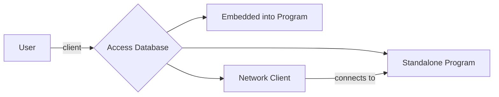
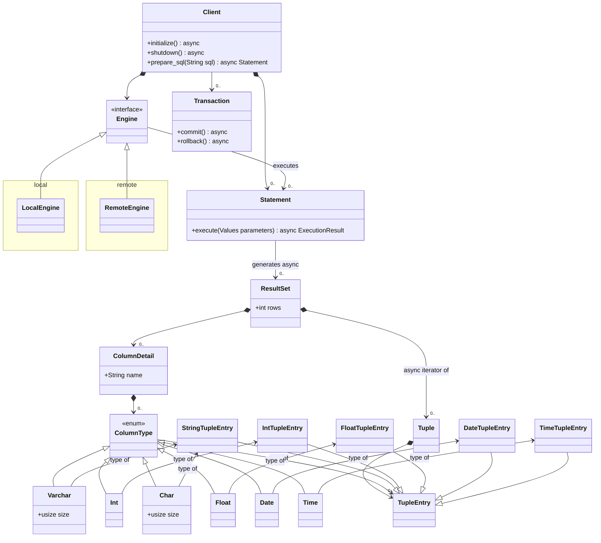
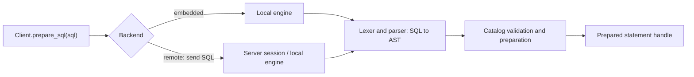
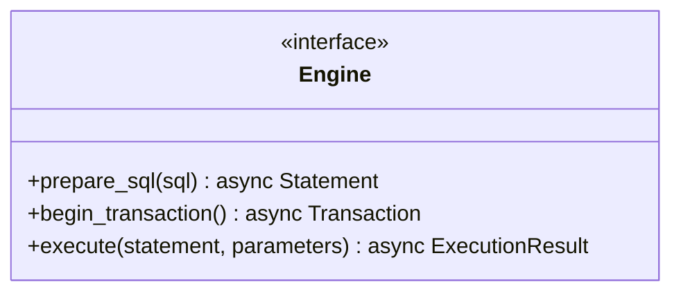

# Design of the Database

## Interaction between User and Database

The user can interact with the database as shown below:

## Database Client

The database client can be modeled as follows:

## SQL String Parser

`Client.prepare_sql(sql)` delegates preparation to its backend. With an embedded
local engine, parsing happens in the application process. With a remote engine,
the client sends SQL to the server and the server's local engine parses it. The
server validates names and types against its catalog and may create an execution
plan. The parser itself performs syntax analysis only.

The AST remains internal to the local engine. The network protocol carries SQL
and separately encoded parameter values, rather than serialized Rust AST types.
This lets the AST evolve without making each parser change a protocol change.

### Prepared statements and parameters

Preparation accepts SQL containing positional `?` placeholders. Execution accepts
an ordered list of typed values. Each placeholder has its own one-based position,
in source order across the whole statement, including subqueries. For example,
`SELECT name FROM users WHERE id = ? AND active = ?` binds `[42, true]`.
The parser represents these as `Expression::Parameter(1)` and
`Expression::Parameter(2)`; it does not bind or interpolate values.

A local statement retains a backend-specific prepared handle. A remote statement
retains a server-issued statement ID associated with its connection/session.
Executing it sends that ID and the parameter values. The engine checks parameter
count and type compatibility and reports binding or execution errors. Repeated
execution can supply different values without reparsing the SQL.

Client libraries may later offer `:name` or `$1` notation. They must normalize it
to `?` before preparation and reorder or duplicate execution values to match each
occurrence. This requires SQL-aware handling that preserves quoted text and comments.
For example, two occurrences of `:id` become two `?` placeholders with the same
value supplied twice. Only `?` is supported by the current parser.

Placeholders represent values, not identifiers, keywords, or SQL fragments.
See the parser design for the currently supported expression positions.

More details regarding the Lexer and Parser semantics, see [here](./sql_query_parser.md).

## Database Engines

The database engine is defined with the following class diagram:

The shared Rust `Engine` trait exposes preparation and execution for both backends.
`Statement.execute(parameters)` delegates to its associated backend/session. The
local engine dispatches over `SqlAction` internally; AST nodes do not invoke an
engine visitor. Begin with a generic `Client<E: Engine>` for backend selection at
compile time. Runtime trait-object dispatch can be introduced if needed.

Transactions are session-bound handles with `commit` and `rollback` operations;
statements executed through a transaction use its session and transaction context.
Execution returns a fallible result containing either row metadata and a row stream,
or command completion with an affected-row count where applicable. DDL does not
need to manufacture a result set.

The same execution entry point handles DML and DDL, including CREATE/DROP INDEX
and ALTER TABLE/VIEW/INDEX. The local engine validates DDL against its catalog and
coordinates schema and storage updates. Index maintenance also happens during
INSERT, UPDATE, and DELETE. These are planned engine responsibilities; the current
engine crate remains a scaffold.

### Local Storage

### Remote Storage

Remote storage means there is an instance of the database running a specific protocol on the network. On the other end of the network would be local storage or a custom engine which stores this another way.
