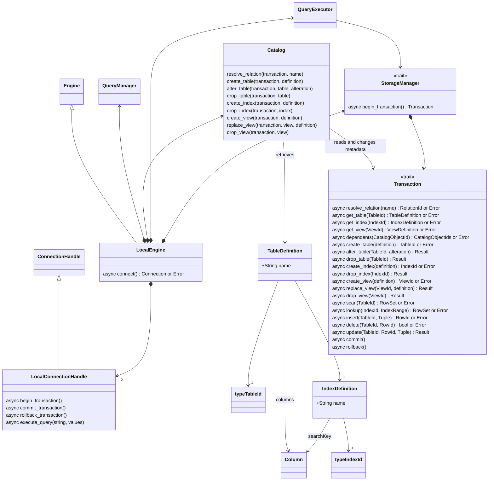
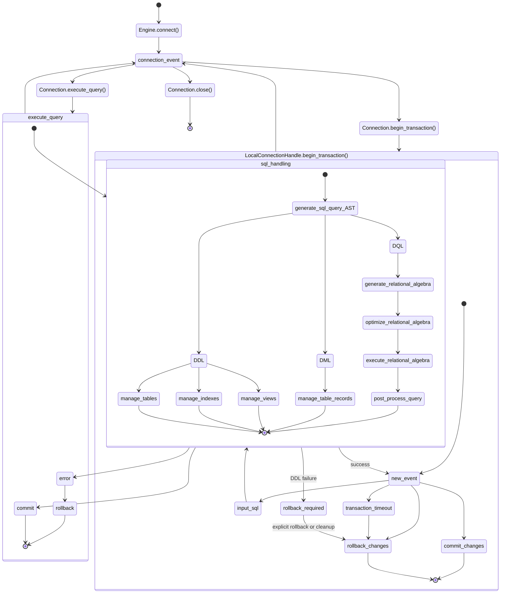

# Local Engine SQL DB

The following class diagram describes the domain model for the local SQL engine.



The diagram shows the internal workings of the database, notice how the `StorageManager` and `Transaction` are traits, this is because we've designed it for people to drop in their own concurrency and storage implementation while we work on the abstractions for managing the table data. Implementations for these different local storage backends can be found here: [in memory](../../in-memory-storage/) and [file based storage](../../file-storage/).

This is how interaction with the database can be modeled as a series of actions:


Concurrent reads and writes and version control is based on the "storage provider".

## Transactional catalog and storage interface

The storage provider owns persistent catalog definitions and the physical
representations of tables and indexes. `StorageManager` opens transactions;
metadata reads, DDL, and row operations use the active storage `Transaction`.
The transaction trait in this document is the internal storage interface, distinct
from the application-facing transaction guard in the `engine` crate. Signatures
in the diagram are conceptual; `Result` denotes a fallible operation.

`Catalog` resolves names, validates database-owned definitions and expressions,
checks dependencies, and coordinates DDL through that transaction. It does not
maintain an independently authoritative copy of metadata. A catalog cache is not
required initially. The engine evaluates SQL expressions; providers need not
interpret parser AST nodes or SQL text.

Metadata changes, row changes, and supporting index changes commit or roll back
together. A transaction observes its own DDL changes. The provider must coordinate
concurrent metadata changes and protect validation reads against conflicting
writes, or report a transaction conflict. Validation followed by an unprotected
metadata write is insufficient. The provider chooses locking, versioning, and
physical allocation strategies while preserving these guarantees.

### Definitions and lookup

The initial catalog has one namespace, without named SQL schemas. Tables and
ordinary views share relation names. `resolve_relation(name)` returns a tagged
`RelationId` identifying a table or view. Definitions use stable table, column,
constraint, index, and view IDs internally so renames do not break references.
Create inputs omit provider-assigned object IDs; successful creation returns the
new ID. Missing objects, name conflicts, invalid definitions, and unsupported
operations return errors.

The ID types identify catalog objects, not their physical storage locations.
`TableId`, `IndexId`, and `ViewId` are distinct opaque identifiers unique within
their respective kinds in one database. `ColumnId` and `ConstraintId` are scoped
to their owning table. IDs remain stable across renames; dropping and recreating
an object creates a new identity. Their numeric representation and allocation
strategy are provider details.

The following conceptual enums make the lookup types explicit:

```rust,ignore
enum RelationId {
    Table(TableId),
    View(ViewId),
}

enum CatalogObjectId {
    Table(TableId),
    Column(TableId, ColumnId),
    Constraint(TableId, ConstraintId),
    Index(IndexId),
    View(ViewId),
}
```

`CatalogObjectId` is a tagged reference to any supported kind of catalog object.
It is not an additional allocated ID. Including the owning table disambiguates
table-scoped column and constraint IDs. `CatalogObjectIds` in the diagram means a
collection of these references. `RelationId` is the narrower type used where only
a table or view is valid. Neither type identifies a data row.

- `TableDefinition` contains its ID, name, ordered column definitions, constraint
  definitions, and associated index IDs.
- `ColumnDefinition` contains its ID, name, SQL type, nullability, and optional
  default expression. Defaults supply values; constraints validate the result.
- `ConstraintDefinition` describes a row-local check, primary key, unique key,
  or foreign key. Keys use ordered column IDs. Foreign keys identify the target
  table and key constraint, with explicit update and delete policies.
- `IndexDefinition` contains its ID, name, table ID, ordered key columns,
  uniqueness, and an optional owning constraint ID. It has one authoritative
  definition; tables reference it by ID.
- `ViewDefinition` contains its ID, name, output columns, a database-owned logical
  query definition, and dependencies on other objects. Original SQL may be kept
  for display. Physical execution plans and upstream parser AST nodes are not
  persisted as the view definition.

`get_table`, `get_index`, and `get_view` return definitions visible to the active
transaction. Definitions are read-only snapshots; callers change them through DDL
operations rather than mutating a returned object. `dependents(CatalogObjectId)` exposes
incoming dependencies, including foreign keys referencing a table, so deletes and
DDL can discover objects not listed among the target's outgoing references.
Providers may derive this lookup from definitions or maintain a transactional map.

Dependencies point from the object that uses another object to the object it
requires: a view depends on its source tables and columns; a foreign-key constraint
depends on its referenced table and key constraint. `dependents` returns direct
incoming dependencies, not a recursive closure. For example,
`dependents(CatalogObjectId::Table(customers_id))` can return views and foreign-key
constraints that reference `customers`. Column-level uses must also record their
table dependency so this lookup discovers them. Ownership is tracked separately:
an index belonging to a table is removed with that table rather than treated as
an external dependency that blocks the drop.

`IndexRange` describes exact composite-key lookup or lower and upper composite-key
bounds, including inclusive, exclusive, and unbounded endpoints. An exact lookup
uses the complete ordered index key. Index IDs identify their owning table.
Internal `RowId` values are separate from SQL primary keys.

`Tuple` means a complete ordered row matching the transaction-visible column
definition. `update` replaces the complete row while preserving its `RowId`;
the engine computes assignments and defaults before calling it. A missing target
row is an error for `update`; `delete` returns `false` when no visible row exists.
Storage scans and index lookups must expose row IDs alongside tuples for mutations.
Their internal row cursor need not use the application-facing `RowSet` type;
`RowSet` in the diagram is shorthand for a fallible sequence of stored rows.

### Creating and altering tables

`create_table` creates both the logical definition and the provider's table
representation. Constraints and their required supporting indexes are included in
the same transactional operation. An empty table does not require a physical
allocation if the provider can represent it lazily.

`alter_table(TableId, TableAlteration)` describes an explicit supported change,
rather than replacing arbitrary metadata. Initial alteration variants are:

| Alteration | Required effect |
| --- | --- |
| Rename table | Update name resolution while preserving the table ID. |
| Rename column | Update its name while preserving the column ID. |
| Add column | Define values for existing rows and validate resulting constraints. |
| Drop column | Reject dependent objects under the initial restricted-drop policy. |
| Add constraint | Validate existing data and create any required backing index. |
| Drop constraint | Check dependencies and remove exclusively owned backing indexes. |

The engine coordinates semantic validation and expression evaluation through the
active transaction. The provider applies the corresponding metadata, row-layout,
and index changes. An added column may rewrite rows or use a logical default for
older rows; both must expose the same SQL behavior. Unsupported alterations,
including type changes initially, return errors before applying the alteration.
No unrestricted `update_table_metadata` setter is exposed.

### Indexes, views, and dependencies

`create_index` builds entries for existing transaction-visible rows and registers
the definition. The storage provider automatically maintains registered indexes
on insert, update, and delete within the same transaction as
their row changes. Commit publishes a complete, consistent index; rollback
discards its creation. The provider coordinates index construction with concurrent
writes and may initially block conflicting writes during the build.

Primary-key and unique constraints own supporting unique indexes. Ordinary indexes
can exist independently. Directly dropping a constraint-owned index is rejected;
the owning constraint must be removed instead. `drop_index` removes both its
definition and its transactional storage representation.

An ordinary view stores a logical query definition without allocating row storage.
`create_view` validates its query and dependencies. `replace_view` preserves the
view ID, checks compatibility with dependent objects, and updates its definition
and dependencies together. Incompatible replacements are rejected. Materialized
views are outside the initial interface.

All drops initially use `RESTRICT`: external dependent objects prevent the drop.
Dropping a table removes its columns, its own constraints, and indexes as part of
the operation, but is rejected if another table's foreign key or a view depends on
it. Dropping a view removes its definition and outgoing dependencies, but is
rejected if other objects depend on it. `CASCADE` is not initially supported.
Catalog coordinates dependency checks and storage applies the changes under the
same transaction's concurrency protection. Physical reclamation may be deferred
until no reader needs the removed objects.

### Failed DDL and rollback

Any error while preparing or executing an identified DDL statement marks its
active transaction as requiring rollback. This includes name-resolution,
validation, unsupported-operation, storage, and dependency errors. A malformed
statement that cannot be classified does not acquire DDL-specific behavior;
general statement-error policy is separate.

After a DDL failure, subsequent SQL execution and `commit` are rejected with a
transaction-aborted error. A rejected commit must not publish changes or make the
connection reusable as though rollback had completed. Partial DDL work remains
uncommitted and is discarded together with earlier work in the transaction when
rollback completes. Statement savepoints and recovery within that transaction
are not initially supported.

In an explicit transaction, the caller must roll back, or dropping the transaction
guard must arrange rollback. Since the public guard's `commit` consumes it, the
backend must also arrange rollback if commit is attempted on an aborted
transaction. Dropping or closing the connection likewise arranges cleanup.
Session reuse waits for cleanup; failed cleanup makes the session unusable.

In autocommit mode, the engine rolls back the failed statement's implicit
transaction before allowing another operation. The original DDL error is returned;
cleanup failure must also be recorded and prevent unsafe session reuse. The
storage provider owns completion and cancellation handling, following the
connection cleanup contract in [the engine design](./README.md#completion-and-cleanup).

The DQL planning path in the interaction diagram is also reused by mutations
such as `UPDATE ... WHERE`, `DELETE ... WHERE`, and `INSERT ... SELECT`; it is
shown once to avoid repeating that pipeline.

### Contracts still to settle before implementation

The interfaces above specify intended behavior but leave the following choices
open. These must not be silently selected by individual storage providers:

- **Isolation and constraint protection:** choose the minimum isolation contract
  for engine validation, including protection of absent-key checks and foreign-key
  checks. Atomic writes alone do not prevent concurrent constraint violations.
- **Non-DDL failures:** decide whether preparation, read, and mutation failures
  abort an explicit transaction. DDL's rollback-required policy is already fixed;
  continuing after a partially applied mutation would require statement rollback.
- **Identifier rules:** specify quoted and unquoted name comparison and the
  namespace for index names. Table/view name sharing alone does not settle these.
- **Index comparison:** specify key ordering, NULL ordering and uniqueness,
  string comparison, and whether prefix bounds are supported. Composite keys alone
  do not define how ranges compare.
- **Creation inputs:** define how columns and constraints inside one create-table
  request reference each other before persistent IDs are assigned, and how the
  engine obtains the assigned IDs afterward. Temporary request-local references
  are one option; parser AST nodes must not cross the storage interface.
- **DDL coordination:** define the exact protocol by which engine-side validation
  and provider-side alterations share concurrency protection, including how
  evaluated default values reach storage when existing rows need backfilling.
- **View replacement:** define output compatibility precisely, including column
  identities, names, order, and types, before implementing `replace_view`.
- **Internal cursors:** choose streaming, borrowing, and cancellation rules for
  storage scans, including whether writes may occur while a cursor is live.

`QueryManager` in the diagram currently denotes the preparation/planning component;
its concrete API and the division between catalog validation and plan construction
are not yet specified. The diagram's engine-to-connection relationship denotes
lifetime dependence: callers own connections, and multiple connections can share
an immutable engine borrow. It does not require the engine to store connection
values. Transaction timeouts in the interaction diagram are optional policy;
no timeout configuration or deadline behavior is specified yet.
