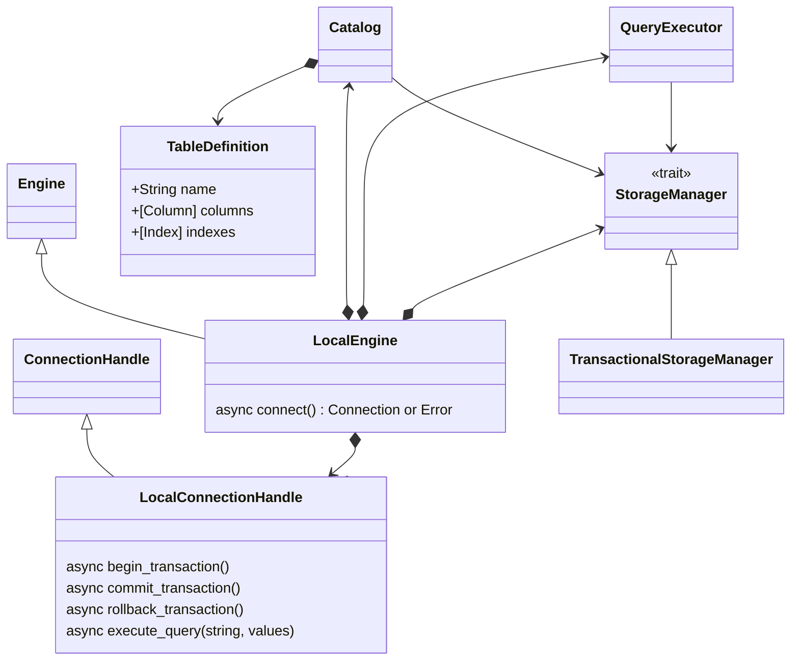

# Local Engine SQL DB

The following class diagram describes the domain model for the local SQL engine.

`LocalEngine::connect` creates a `LocalConnectionHandle`. Each handle references
the shared database state (for example through `Arc`) and owns independent session
and transaction state.

The local engine owns shared database state: catalog, tables, indexes, and the
page/storage manager. It must not hold a single global current transaction.
Each local connection handle identifies its own active transaction, and execution passes
that context down to storage. Commit/rollback need actual storage support for
atomicity and isolation; adding session handles alone does not provide those
properties. Transactional DDL and catalog updates must participate in the same
commit/rollback mechanism when supported.

The generic engine/session wrappers exist, but no local storage backend currently
implements these interfaces. Atomicity and isolation still require storage support.
