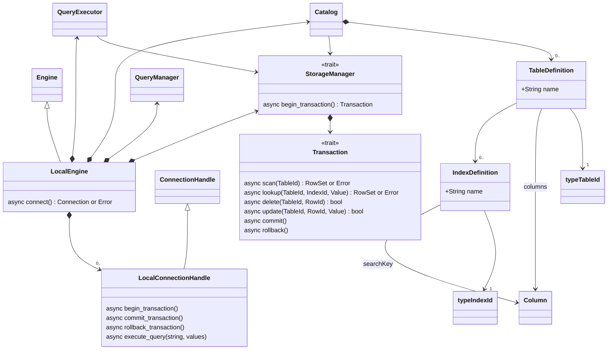
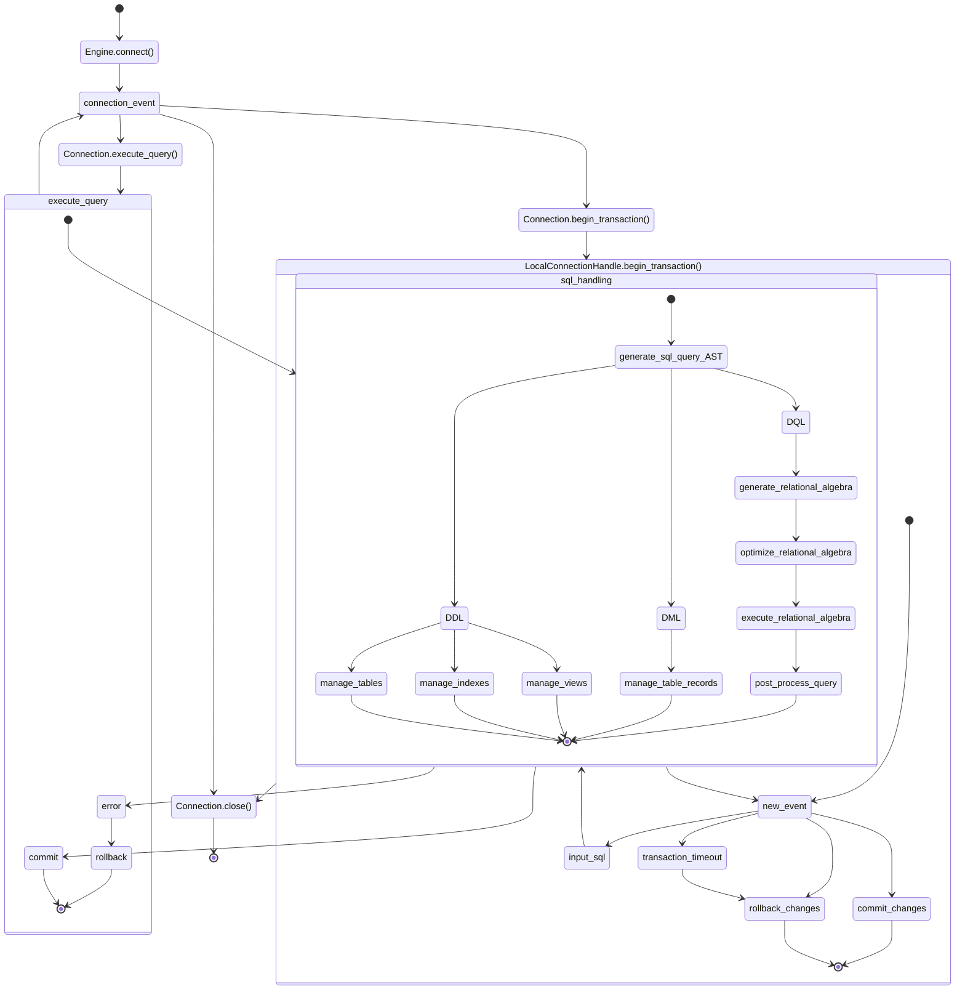

# Local Engine SQL DB

The following class diagram describes the domain model for the local SQL engine.

The diagram shows the internal workings of the database, notice how the `StorageManager` and `LocalConnectionHandle` are traits, this is because we've designed it for people to drop in their own concurrency and storage implementation while we work on the abstractions for managing the table data. Implementations for these different local storage backends can be found here: [in memory](../../in-memory-storage/) and [file based storage](../../file-storage/).

This is how interaction with the database can be modeled as a series of actions:

Each transaction acts in isolation keeping its own session data to be "merged" into the main version of the database. Concurrent reads and writes and version control is based on the "storage provider".